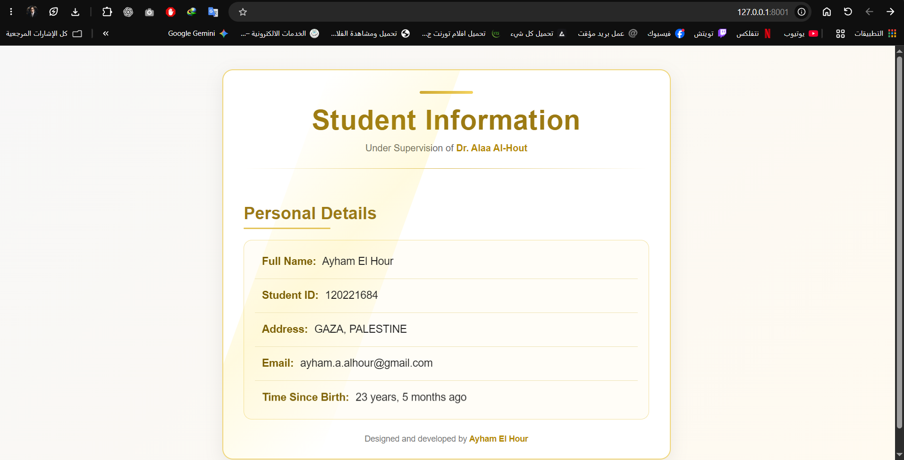
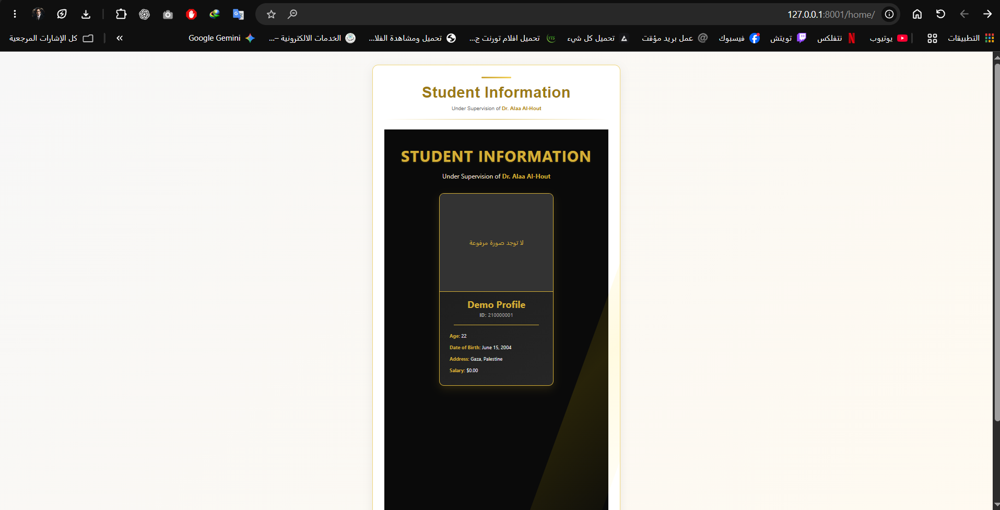
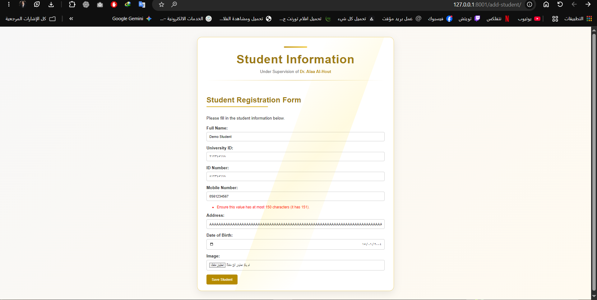
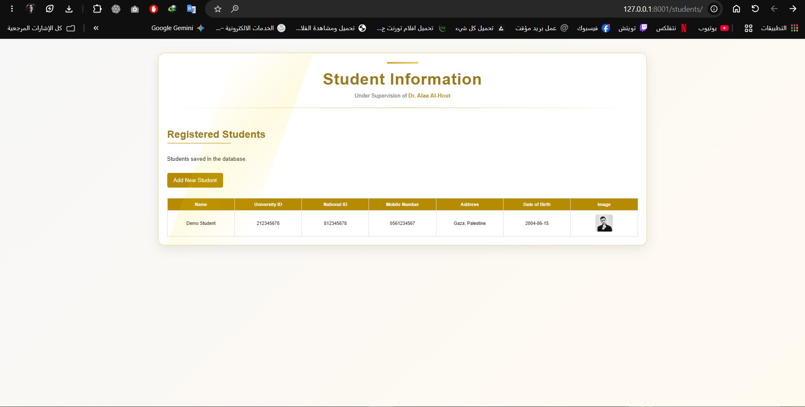
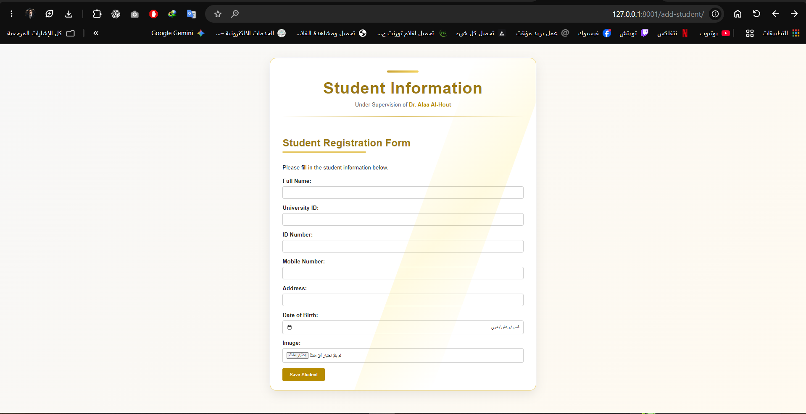

<div align="center">

# Django Learning Journey
### Web Programming 3 · WEBC4301

**From Django Templates to Database-Backed Student Registration**

A documented collection of course assignments showing how one Django project evolved through templates, models, forms, validation, and testing.

**Student:** Ayham El Hour · [GitHub: MR7PRO](https://github.com/MR7PRO)\
**Course supervisor:** Dr. Alaa Al-Hout\
**Stack:** Python · Django 6.1.2 · SQLite · HTML/CSS · Pillow

</div>

---

## About this repository

This repository collects the working Django project and its course learning milestones. Each assignment builds on concepts taught in the course, and earlier routes and features remain available for review. The source code is intentionally straightforward and organized around Django's Model–View–Template architecture.

The accompanying documents explain **what was required**, **what was implemented**, **how it was tested**, and **what changed between assignments**. Earlier work is tied to real commits in the original repository rather than reconstructed commit dates.

## Assignment overview

| Milestone | Topic | Key learning outcomes | Documentation |
|---|---|---|---|
| 01 · Oct 16, 2026 | Templates & Context | `render()`, context dictionaries, DTL filters, `extends`, `block`, `include` | [Assignment 01](docs/assignments/01-templates-context.md) |
| 02 · Oct 27, 2026 | Models & Admin | `StudentProfile`, SQLite, migrations, Django Admin, media and database queries | [Assignment 02](docs/assignments/02-models-admin.md) |
| 03 · Nov 6, 2026 | Forms & Validation | `ModelForm`, field validation, image uploads, database saving, HTML table, error messages | [Assignment 03](docs/assignments/03-student-registration.md) |

See the [Development Journey](docs/DEVELOPMENT_JOURNEY.md) for a chronological account with source commit references and evidence status. The [Fresh Setup Verification](docs/FRESH_SETUP_VERIFICATION.md) records results from the new local repository. Evidence from all three assignments is linked below. The Assignment 03 screenshots and the Assignment 01/02 page views were visually reviewed in the local walkthrough on November 6, 2026.

## Earlier assignments · Visual evidence

| Assignment 01 — Templates & context | Assignment 02 — Model-backed profile |
|---|---|
|  |  |

The first image retains the coursework author's original details. The second shows a newly inserted demonstration profile in the clean SQLite database.

## Assignment 03 · Visual evidence

The clean-project walkthrough confirmed an address-length error, a successfully saved student, and the seven-field registration form. The screenshots below document those observations. The owner has chosen to keep the original coursework identity details; see [Publication review](docs/PUBLICATION_REVIEW.md) for public-visibility considerations.

| Address-length validation | Saved student listing | Registration form |
|---|---|---|
|  |  |  |

[Detailed Assignment 03 evidence and QA](docs/assignments/03-student-registration.md)

## Pages

| URL | Purpose |
|---|---|
| `/` | Original assignment: student information rendered from a Django context |
| `/home/` | Earlier assignment: saved student profiles displayed from the database |
| `/add-student/` | New student registration form with validation and file upload |
| `/students/` | Formatted table of registered students and an “Add New Student” link |
| `/admin/` | Built-in Django administration |

## Verified clean-environment setup (November 6, 2026)

The new repository was cloned as an empty repository, and a clean copy of the Django source was transferred **without the former Git history, SQLite database, virtual environment or uploaded files**. The following results were observed on Windows with Python 3.14 and a new virtual environment:

| Check | Actual observation |
|---|---|
| `python -m pip install -r requirements.txt` | Installed pinned Django 6.1.2, Pillow 13.0.0 and other requirements |
| `python -m pip check` | `No broken requirements found.` |
| `python manage.py check` | `System check identified no issues (0 silenced).` |
| `python manage.py migrate` | Completed all initial migrations successfully |
| `python manage.py showmigrations pages` | Both `0001_initial` and `0002_student` checked `[X]` |
| `python manage.py runserver 8001` | Development server started successfully |
| `GET /students/` | HTTP `200` |
| `GET /add-student/` | HTTP `200` |
| Invalid registration POST | HTTP `200` (form re-rendered; precise field error not identifiable from server log alone) |
| Valid registration POST | HTTP `302` redirect |
| Redirect to `/students/` | HTTP `200` |
| Uploaded image request | HTTP `200` |

These logs support a working save → redirect → list → image workflow in the fresh clone. Browser screenshots were visually reviewed: the 151-character address displays the server-side Django length error, the registered student appears in the table, and all seven form fields are present. The legacy `/` page also rendered, and a sample `StudentProfile` record rendered at `/home/`. These observations are manual, not automated tests.

## Assignment 03 requirements and evidence

The latest assignment supports the following fields: full name, 9-digit unique university ID starting with `1` or `2`, 9-digit national ID starting with `9`, `8`, or `4`, a 10-digit mobile number starting with `059` or `056`, an address of up to 150 characters, date of birth, and a JPG/PNG image.

The form uses Django `ModelForm`, `is_valid()`, server-side field validation, and built-in model uniqueness validation. A successful POST stores the student and redirects to the table page.

**Observed manual QA (Nov 6, 2026):** successful record creation and image display; rejection of empty required fields, duplicate university IDs, invalid field prefixes and lengths, numbers in names, GIF uploads, and 151-character addresses. These checks were observed in local browser screenshots and/or Django shell during coursework. In the new clone, server logs show a valid submission and image response, while screenshots show the actual 151-character error and the resulting student table. This is **not** a claim of an automated test suite.

## Run locally (Windows)

Requirements: Python and Git. Run commands from the folder containing `manage.py`.

```powershell
python -m venv .venv
.venv\Scripts\activate
python -m pip install -r requirements.txt
python manage.py migrate
python manage.py check
python manage.py runserver
```

Open `http://127.0.0.1:8000/`, then visit the URLs in the Pages table above. The project uses SQLite for local development. Optional administrator setup:

```powershell
python manage.py createsuperuser
```

**Note:** The local database and uploaded media are intentionally not distributed. On a fresh clone, the student table starts empty; add a fictional test student via `/add-student/` to verify the complete flow.

## Project layout

```text
.
├── manage.py
├── project/               # Django settings and main routing
├── pages/                 # Models, views, forms, migrations, admin, URLs
├── Templates/pages/       # Reused base template and assignment pages
├── docs/
│   ├── DEVELOPMENT_JOURNEY.md
│   ├── RELEASE_CHECKLIST.md
│   ├── assignments/
│   └── screenshots/       # Reviewed evidence only
├── requirements.txt
└── .gitignore
```

## Original development records

The earlier repository remains unchanged and available for auditing: [django-templates-context-assignment-](https://github.com/MR7PRO/django-templates-context-assignment-).

- [Oct 16 · Initial Django assignment](https://github.com/MR7PRO/django-templates-context-assignment-/commit/3db68836bc)
- [Oct 16 · README and screenshots](https://github.com/MR7PRO/django-templates-context-assignment-/commit/ce33340fd5)
- [Oct 27 · Models, Admin, and UI](https://github.com/MR7PRO/django-templates-context-assignment-/commit/711b95fdd9)

The third assignment was implemented and tested locally on Nov 6; the new repository commit should reflect the **actual publication date**, not be backdated. The current repository begins as a clean snapshot, while the older repository preserves independent historical evidence.

## Privacy and academic transparency

The repository intentionally retains the student author’s original coursework name, university ID and email in the Assignment 01 example, by the owner’s choice. **These details will be visible to anyone if the repository is public.** Registration examples use demo data; they must not be treated as actual student records. Do not commit `.venv/`, `db.sqlite3`, `.env`, raw uploaded media, credentials, or unapproved third-party portraits. See [Publication review](docs/PUBLICATION_REVIEW.md). Earlier commits are linked accurately; no historic commits or test results have been fabricated.

---

*Prepared as a student coursework repository for review and learning, not as a production deployment.*
