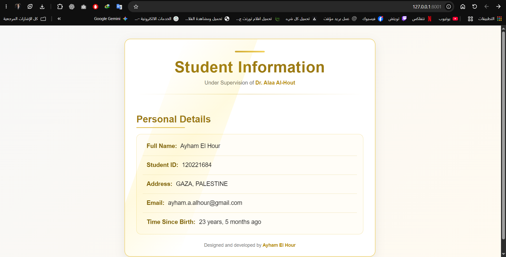

# Assignment 01 — Django Templates & Context

**Recorded:** October 16, 2026\
**Focus:** Django views, context dictionaries, template inheritance and DTL filters.

## What this assignment demonstrates

A view in `pages/views.py` creates a Python context dictionary and passes its values to `Templates/pages/index.html` using `render()`. The page inherits a shared `base.html` and includes `footer.html`.

The template uses the course filters `capfirst`, `add`, `stringformat:"s"`, `upper`, `default`, and `timesince` to format data in the presentation layer.

## Where to review it

- Route: `/`
- View: `pages/views.py → index`
- Template: `Templates/pages/index.html`
- Shared templates: `Templates/pages/base.html` and `footer.html`
- Original documentation and desktop/mobile screenshots: [earlier README commit](https://github.com/MR7PRO/django-templates-context-assignment-/commit/ce33340fd5)

## Evidence and provenance

- [Initial Django assignment commit](https://github.com/MR7PRO/django-templates-context-assignment-/commit/3db68836bc)
- [Documentation/screenshots commit](https://github.com/MR7PRO/django-templates-context-assignment-/commit/ce33340fd5)

The local route `/` rendered correctly on November 6, 2026. The screenshot preserves the author’s original coursework name, university ID and email by the owner’s decision; these become public if the repository remains public.
