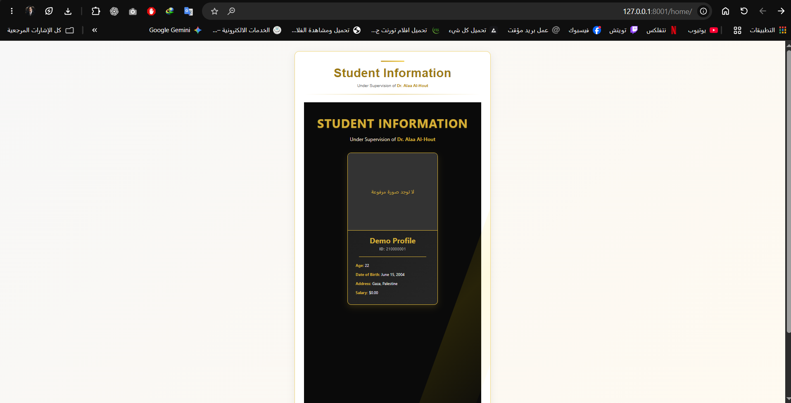

# Assignment 02 — Django Models, SQLite and Admin

**Recorded:** October 27, 2026\
**Focus:** ORM, migrations, Django Admin, media files and displaying stored data.

## What this assignment demonstrates

Added a `StudentProfile` model in `pages/models.py` with name, university ID, age, date of birth, address, salary and uploaded image. The corresponding migration `0001_initial.py` creates the model schema.

Registered `StudentProfile` in `pages/admin.py`, added sample entries via Django Admin, and displayed saved profiles at `/home/` using `StudentProfile.objects.all()` and a template loop.

## Where to review it

- Route: `/home/`
- Model: `pages/models.py → StudentProfile`
- Migration: `pages/migrations/0001_initial.py`
- Admin: `pages/admin.py`
- Template: `Templates/pages/home.html`

## Evidence and provenance

- [Models, Admin, and UI commit](https://github.com/MR7PRO/django-templates-context-assignment-/commit/711b95fdd9)

In a fresh database on November 6, 2026, a local `Demo Profile` was inserted into `StudentProfile` and visibly rendered at `/home/`, including the no-photo placeholder. The sample database itself is not distributed.
