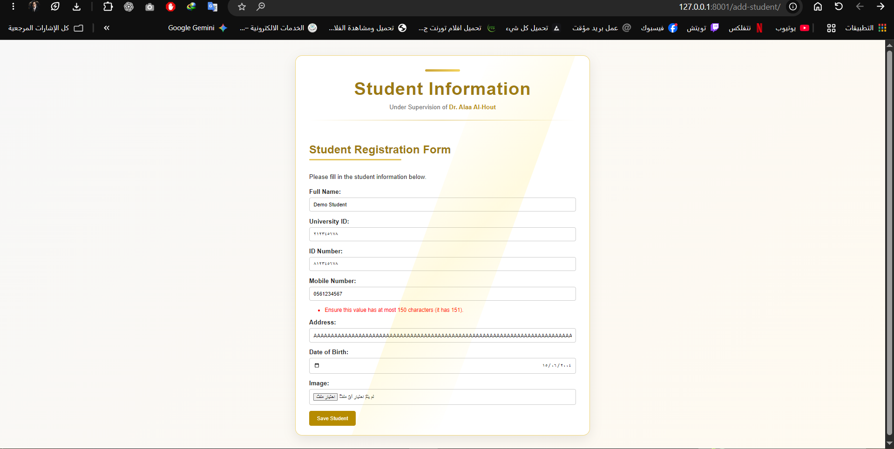
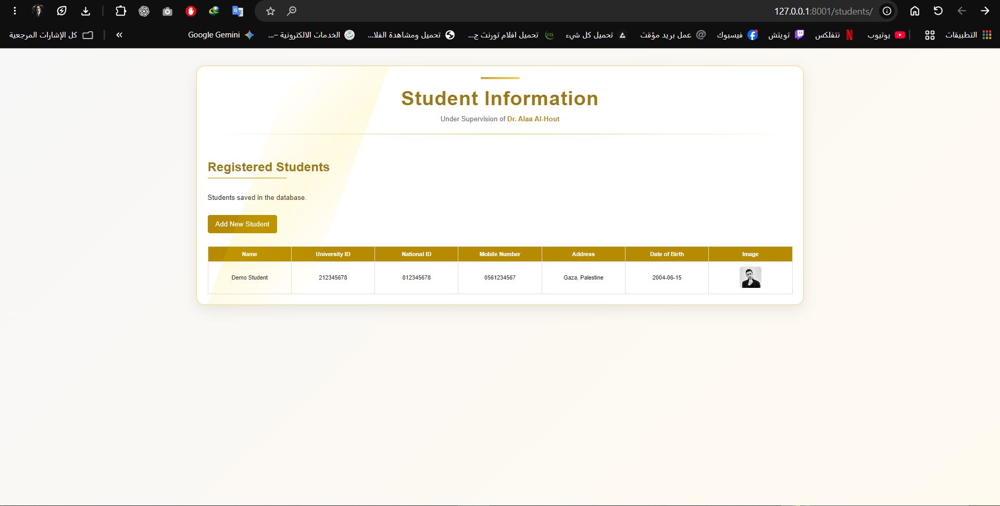
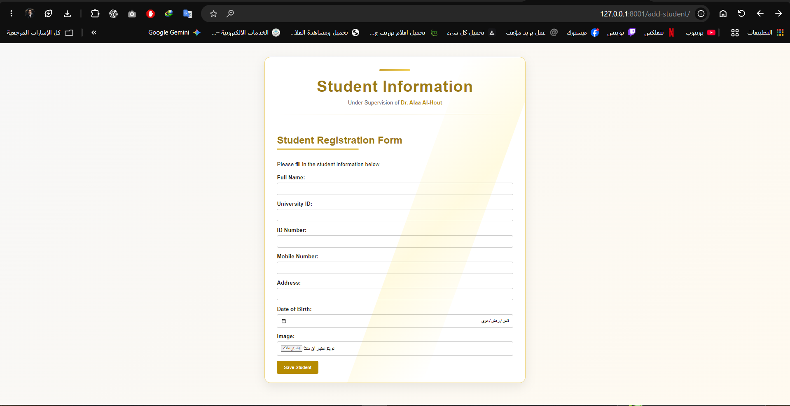

# Assignment 03 — Student Registration with Django Forms

**Implemented and manually tested:** November 6, 2026\
**Focus:** `ModelForm`, server-side validation, image upload, database save and formatted table.

## Requirements

| Field | Type | Rule |
|---|---|---|
| Full name | `CharField` | Letters and spaces only |
| University ID | `IntegerField` | Exactly nine digits; starts with 1 or 2; unique |
| National ID | `IntegerField` | Exactly nine digits; starts with 9, 8 or 4 |
| Mobile number | `CharField` | Ten digits; starts with 059 or 056 |
| Address | `CharField` | Maximum 150 characters |
| Date of birth | `DateField` | Valid date |
| Image | `ImageField` | Valid JPG/JPEG or PNG image |

## Implementation

- `pages/models.py`: standalone `Student` model, preserving earlier `StudentProfile`.
- `pages/forms.py`: `StudentForm(forms.ModelForm)` and field-specific validation methods.
- `pages/views.py`: `add_student` handles GET/POST and `request.FILES`, calls `is_valid()`, saves, redirects; `student_list` returns all student entries.
- `pages/urls.py`: routes for `/add-student/` and `/students/`.
- `Templates/pages/add_student.html`: form using `POST`, `enctype="multipart/form-data"`, ``, and `{{ form.as_p }}`.
- `Templates/pages/student_list.html`: seven-column table and dynamic `Add New Student` link.

## Tested behavior

| Test | Result observed locally |
|---|---|
| Save valid student with PNG | Saved and rendered in the table |
| Duplicate university ID | Rejected with field-specific error |
| Invalid ID/mobile prefixes | Rejected |
| 8-digit university/national IDs | Rejected |
| 9-digit mobile number | Rejected |
| Name with numbers | Rejected |
| GIF image | Rejected |
| Address of 151 characters | Rejected with server-side validation message |
| Blank required fields | Blocked by browser required-field handling |

These are **manually observed** test outcomes, not claims about automated unit tests.

## Screenshot evidence in the new repository

The following images were saved in `docs/screenshots/assignment-03/` and visually reviewed during the coursework walkthrough:

### Address length validation

### Successful registration and student listing

### Registration form

Other historical checks (duplicate IDs, numeric lengths, GIF upload) were carried out in the original local project; those specific screenshot files are not yet included in this new repository. They should be added only if available and privacy-reviewed.

**Fresh clone test log:** an invalid `POST /add-student/` returned HTTP 200 and re-rendered the form; a valid POST returned HTTP 302, followed by HTTP 200 for `/students/` and the saved image. The HTTP response codes alone do not prove a specific field error, but the address-validation screenshot independently shows the exact 151-character Django error.

## Learning takeaway

Django validation must be enforced on the server side. Removing `maxlength` from the HTML widget only allows the invalid 151-character value to reach Django; it **does not remove** the `max_length=150` rule in `StudentForm`/the model. The result is a clear error rendered in the original registration page.
